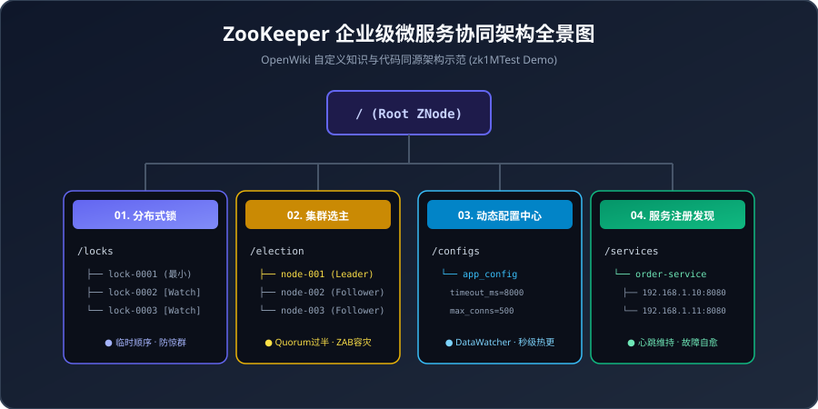

# ZooKeeper 生产协同与架构实战 (zk1MTest)

> 本仓库作为 **OpenWiki 自定义知识与 GitOps 自动化流水线** 的官方示范工程，不仅包含生产级 Java 演示代码，还在 `doc/knowledge/` 目录下完整沉淀了团队权威的技术规约、Mermaid 时序图与高频故障排错手册。

---

## 📚 场景 Wiki 文档体系 (按场景归档)

每个典型分布式场景均拥有独立的标准规范文档，提交后将由 OpenWiki 流水线自动提取并融合至 **Web 3D 知识图谱**、**静态 Wiki 阅读器** 以及 **IDE/Cursor MCP 智能体**：

| 场景编号 | 场景主题 | 核心规约与关键机制 | 对应 Wiki 文档 | 对应 Java 演示代码 |
| :---: | :--- | :--- | :--- | :--- |
| **01** | **分布式锁落地** | 临时顺序节点 (`EPHEMERAL_SEQUENTIAL`)、前序节点监听、彻底消灭惊群效应 (Herd Effect) | [01-distributed-lock.md](doc/knowledge/01-distributed-lock.md) | `com.openwiki.demo.lock.DistributedLockDemo` |
| **02** | **集群规划与选主** | 奇数节点容灾公式、Quorum 过半机制、Leader/Follower/Observer 角色分工与 ZAB 协议 | [02-cluster-election.md](doc/knowledge/02-cluster-election.md) | `com.openwiki.demo.election.LeaderElectionDemo` |
| **03** | **生产排错与 FAQ** | Session Expired 与 JVM STW/GC 调优、脑裂预防、磁盘事务日志自动清理 (`autopurge`) | [03-troubleshooting-faq.md](doc/knowledge/03-troubleshooting-faq.md) | `ZkRepro.java` (含 1MB Jute 大报文规约) |
| **04** | **动态配置中心** | 持久节点与 DataWatcher、配置秒级下发热生效、防止循环触发与本地容灾缓存 | [04-dynamic-config.md](doc/knowledge/04-dynamic-config.md) | `com.openwiki.demo.config.ConfigCenterDemo` |
| **05** | **服务注册与发现** | 临时节点心跳存活感知、实例宕机自动摘除、客户端软负载均衡与容灾 | [05-service-discovery.md](doc/knowledge/05-service-discovery.md) | `com.openwiki.demo.registry.ServiceRegistryDemo` |

---

## 🏛️ 架构全景示意图



---

## ⚙️ OpenWiki 自定义知识接入规范

根目录包含 `.openwikirc`，声明团队自定义知识目录：
```json
{
  "knowledge_dir": "doc/knowledge",
  "comment": "OpenWiki 业务团队自定义知识目录配置"
}
```

### GitOps 极速生效流
日常业务研发提交或更新了 ZK 场景规范后：
1. 正常提交并推送到 Git 主干分支；
2. 触发日间构建通道（`mode: knowledge-only`），跳过昂贵的全量代码扫描，几十秒内自动完成 Frontmatter 补齐、静态图片镜像复制与知识图谱并网；
3. 在 Cursor / Windsurf 中提问：“*ZK 分布式锁如何避免惊群？*” 或 “*Session Expired 怎么排查？*”，AI 将通过 MCP 工具自动读取上述规范并准确解答。
