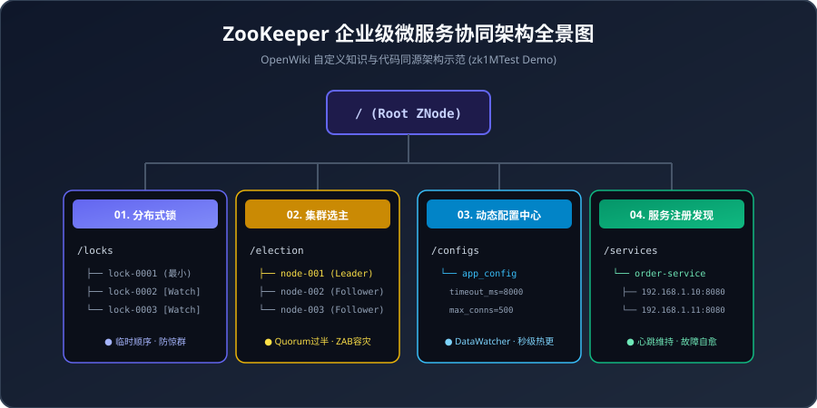

# ZooKeeper 协同架构与业务场景全景指南

> **定位：** 本文统领展示 ZooKeeper 在微服务体系下的四大核心能力（分布式锁、集群选主、配置中心、服务发现）以及在树形 ZNode 命名空间下的完整拓扑。

## 1. 架构与命名空间设计全景

以下为生产级 ZooKeeper 在微服务体系下的核心 ZNode 树形拓扑与职责分布：

---

## 2. 四大业务场景核心机制速查

| 核心模块 | ZNode 路径规划 | 节点类型 | 关键机制与保障 | 对应专题规范 |
| :--- | :--- | :--- | :--- | :--- |
| **01. 分布式锁** | `/locks/lock-000000000X` | 临时顺序节点 (`EPHEMERAL_SEQUENTIAL`) | 最小序号获锁，前序 Watcher 监听，**彻底杜绝惊群效应 (Herd Effect)** | [01-distributed-lock.md](01-distributed-lock.md) |
| **02. 集群选主** | `/election/node-000000000X` | 临时顺序节点 (`EPHEMERAL_SEQUENTIAL`) | 最小序号当选 Leader，Quorum 过半机制，ZAB 崩溃恢复容灾 | [02-cluster-election.md](02-cluster-election.md) |
| **03. 配置中心** | `/configs/app_config` | 持久节点 (`PERSISTENT`) | DataWatcher 持续监听 `NodeDataChanged`，零重启毫秒级热加载 | [04-dynamic-config.md](04-dynamic-config.md) |
| **04. 服务发现** | `/services/{service_name}/{ip:port}` | 临时节点 (`EPHEMERAL`) | 会话长连接心跳，实例掉线秒级自动摘除，客户端软负载均衡 | [05-service-discovery.md](05-service-discovery.md) |

---

## 3. 生产运维与避坑指南
生产高频故障（如 JVM Full GC 引发的 **Session Expired**、磁盘被打满的 **autopurge** 规约、以及 **1MB Jute 大报文限制**）详细排查步骤请参考专题手册：
- [03-troubleshooting-faq.md](03-troubleshooting-faq.md)
