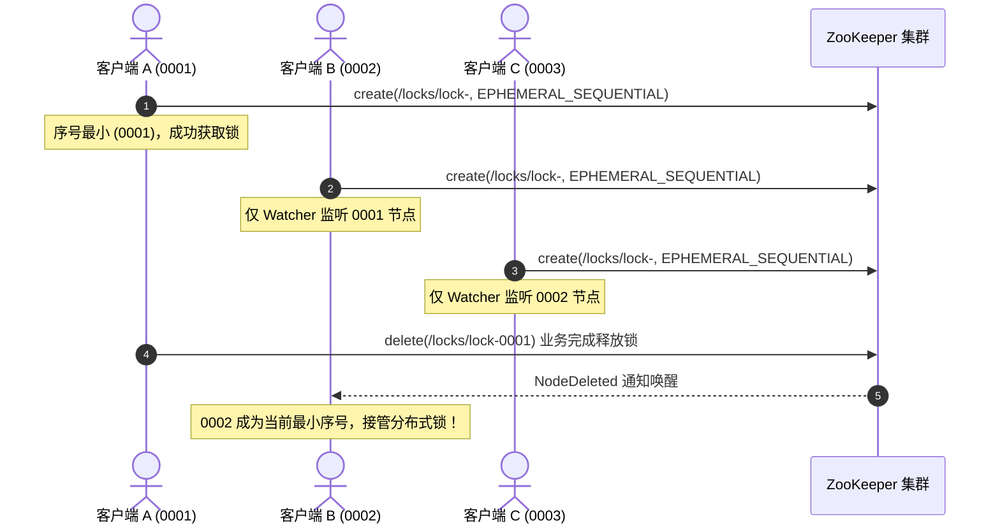

# ZooKeeper 分布式锁落地与防惊群规范

> **适用场景：** 跨微服务交易结算、防超卖库存扣减、定时任务幂等触发、全局资源互斥。

## 1. 痛点：为什么要严格防惊群 (Herd Effect)？
在分布式系统中，如果采用简单的抢占模式（如所有客户端在 `/lock/resource` 下并发创建同一个临时节点）：
- 当锁持有者释放节点时，ZooKeeper 会向所有监听该节点的成百上千个客户端同时发送 `NodeDeleted` 事件；
- 瞬间引发网络风暴、CPU 尖刺与吞吐量剧降，这就是经典的**惊群效应 (Herd Effect)**。

## 2. 核心架构设计 (Ephemeral Sequential)
必须采用基于 **临时顺序节点 (EPHEMERAL_SEQUENTIAL)** 的排队唤醒机制：

### 标准执行步骤
1. **创建节点：** 客户端调用 `create("/locks/lock-", data, OPEN_ACL_UNSAFE, CreateMode.EPHEMERAL_SEQUENTIAL)`。
2. **序号比对：** 调用 `getChildren("/locks", false)` 获取当前所有子节点并按字母序递增排序。
3. **获取成功：** 若当前客户端的节点序号在列表中排在第 0 位，则判定为**成功获取锁**。
4. **防惊群监听：** 若不是第 0 位，找到排在自己前一号的节点 `prevNode`，调用 `exists("/locks/" + prevNode, watcher)` 仅对该前驱节点注册监听。
5. **前驱唤醒：** 前驱节点被删除（正常释放或客户端故障掉线）时，触发当前客户端重新检查是否排到最小序号。

## 3. 超时保护与异常容灾规约
- **进程宕机容灾：** 由于创建的是临时节点（Ephemeral），当业务节点发生机器宕机、内核崩溃等极端情况时，ZooKeeper 会话超时会自动删除该节点，后序等待者自动接管，**绝不发生死锁**。
- **主动释放：** 必须在 Java `finally` 块或 Go `defer` 中执行显式节点删除，避免长事务占锁。
- **等待超时：** 客户端获取锁必须设置超时上限（如 10 秒），防止死等导致上游 HTTP 连接池耗尽。

## 4. 对应落地代码
- 详见源码：`src/main/java/com/openwiki/demo/lock/DistributedLockDemo.java`
