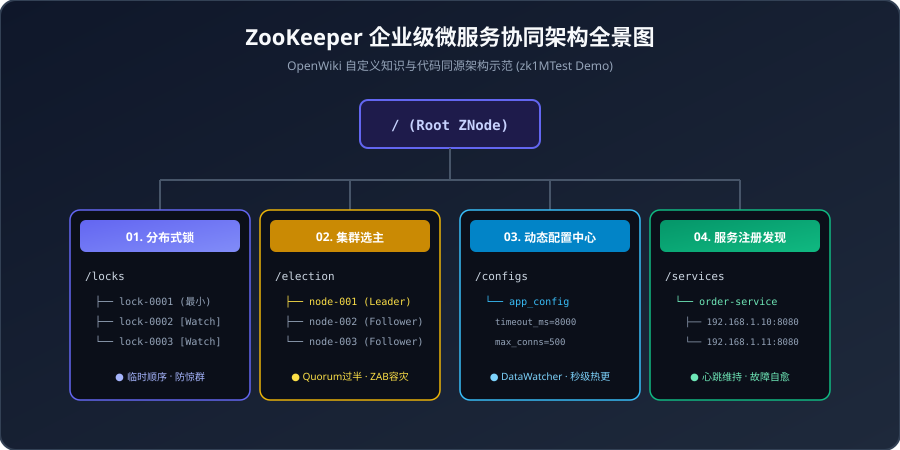
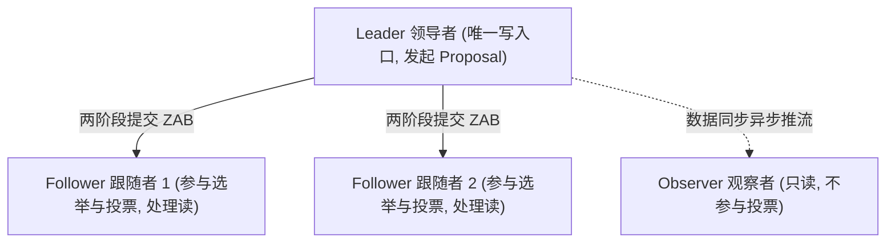

# ZooKeeper 生产集群架构规划与选主机制

> **适用场景：** 生产级 ZooKeeper 高可用集群部署规划、容灾容量计算、分布式主备选举 (Master-Worker)。

## 0. 集群协同拓扑与命名空间全景

## 1. 生产环境集群规格与过半机制 (Quorum)
ZooKeeper 依赖 ZAB (ZooKeeper Atomic Broadcast) 协议保证强一致性。为了防止脑裂并保证一致性，写操作和选举必须满足**大多数节点同意 (Quorum = N / 2 + 1)**：

| 集群节点总数 (N) | 法定过半数 (Quorum) | 最大可容忍故障节点数 | 推荐环境 |
| :---: | :---: | :---: | :--- |
| **3** | 2 | **1** | 测试 / 预生产 / 轻量级业务 |
| **4** | 3 | **1** | ❌ **不推荐** (容灾能力与 3 节点相同，成本多 33%) |
| **5** | 3 | **2** | 🏆 **生产级标准推荐** (兼顾性能与高可用) |
| **7** | 4 | **3** | 超大规模核心基础设施 |

> **强制规约：** 生产集群节点数**必须为奇数**！偶数节点不仅无法提升容灾能力，反而在网络分区时更容易陷入无法凑齐法定半数的僵局。

## 2. 角色职责分工

- **Leader (领导者)：** 整个集群的核心协调者，负责处理所有事务写请求，分配全局单调递增的事务 ID (`zxid`) 并发起两阶段提交广播。
- **Follower (跟随者)：** 负责处理并发读请求；参与 Leader 选举投票，参与写操作的提议投票。
- **Observer (观察者)：** 仅同步 Leader 状态并处理读请求，**不参与任何写投票与选主选举**。用于跨机房灾备或提升只读吞吐量，且不拖慢写性能。

## 3. 选主流程核心规则 (Fast Leader Election)
当 Leader 节点网络断开或宕机后，Follower 会立刻切换状态为 `LOOKING`，进入快速选主阶段：
1. **优先比较事务 ID (`zxid`)：** `zxid` 最大的节点包含最新的已提交事务，拥有最高选举优先级。
2. **次要比较服务器 ID (`myid`)：** 若所有候选节点的 `zxid` 相同，则选举 `myid` 最大的机器为 Leader。
3. **状态切换：** 获胜者当选为 `LEADING`，其余节点变为 `FOLLOWING`，并完成数据对齐与同步。

## 4. 对应落地代码
- 详见源码：`src/main/java/com/openwiki/demo/election/LeaderElectionDemo.java`

