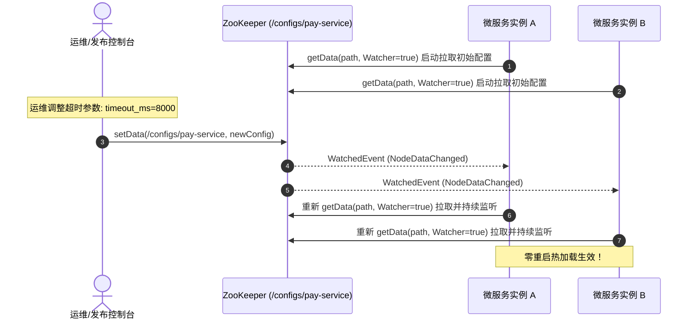

# 微服务分布式配置中心与动态感知规范

> **适用场景：** 微服务运行时开关（Feature Flag）、限流阈值动态下发、灰度路由权重实时调整。

## 1. 架构交互模型
将微服务的全局动态配置保存在 ZooKeeper 持久节点（如 `/configs/{app_name}`）中。微服务启动时一次性载入并注册持久 Watcher，配置变更时秒级推送并热更新内存：

## 2. 规约与防坑指南
1. **Watcher 一次性触发特性：**
   ZooKeeper 的原生 Watcher 在触发一次后失效。因此，在收到 `NodeDataChanged` 重新读取数据时，**必须重新传递 Watcher 实例**，保证持续监听。
2. **本地容灾缓存兜底：**
   微服务在首次读取配置成功后，建议在本地内存或临时目录持久化一份快照。即使 ZooKeeper 出现短暂断网，应用依然能基于上一次有效配置稳定运行。
3. **避免过度频繁写入：**
   配置中心适合“低频写、高频读”。严禁业务代码将计数器或高频状态写入配置节点，否则将持续引发全网广播风暴。

## 3. 对应落地代码
- 详见源码：`src/main/java/com/openwiki/demo/config/ConfigCenterDemo.java`
