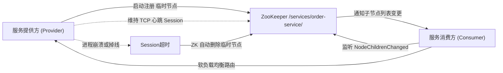

# 分布式服务注册与健康检查最佳实践

> **适用场景：** RPC 服务治理、微服务自动寻址、动态健康检测与上下线容灾。

## 1. 命名空间与 ZNode 层次设计
建议在 ZooKeeper 根命名空间规划统一格式：
```text
/services
└── order-service (微服务名称, 持久节点)
    ├── 192.168.1.100:8080 (临时节点, 实例 A)
    ├── 192.168.1.101:8080 (临时节点, 实例 B)
    └── 192.168.1.102:8080 (临时节点, 实例 C)
```

## 2. 节点生命周期与健康检测


### 关键机制
1. **自动注册与下线：**
   服务提供者启动时在 `/services/{service_name}/{ip:port}` 创建**临时节点 (EPHEMERAL)**。
   - 优雅退出：进程停机钩子（Shutdown Hook）主动删除节点；
   - 异常宕机：心跳丢失超过 Session 超时时间，集群自动将该实例从列表中摘除，防止消费端请求打到死机节点。
2. **消费端监听：**
   消费端调用 `getChildren(path, true)` 注册子节点监听器，当实例上线或故障摘除时，本地负载均衡列表秒级自动刷新。
3. **负载均衡：**
   消费端本地维护实例缓存，采用 Round-Robin（轮询）或加权随机算法分配请求。

## 3. 对应落地代码
- 详见源码：`src/main/java/com/openwiki/demo/registry/ServiceRegistryDemo.java`
